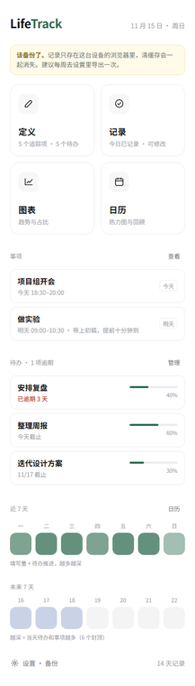
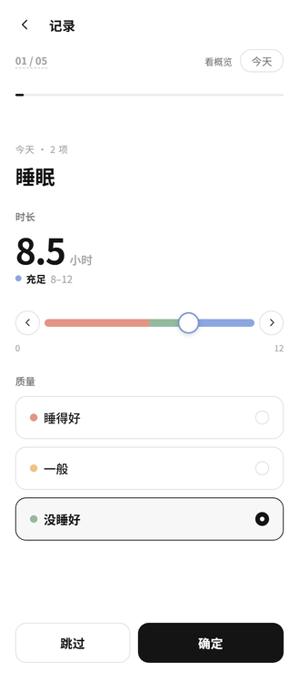
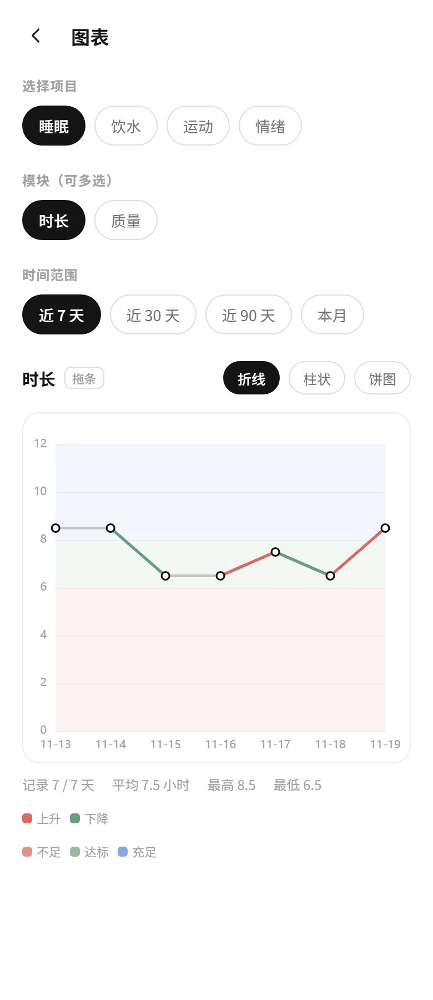
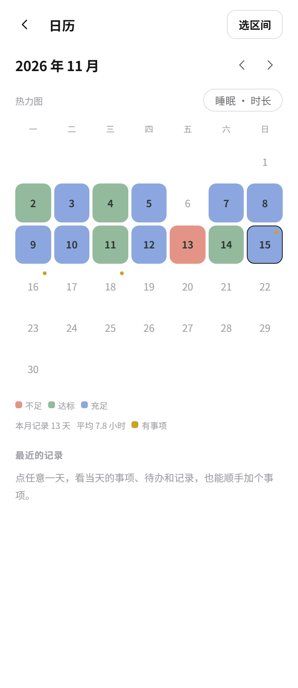
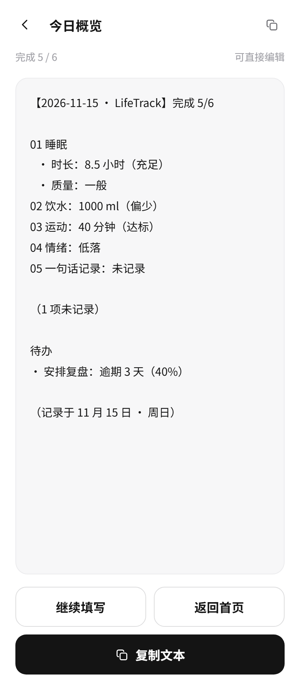
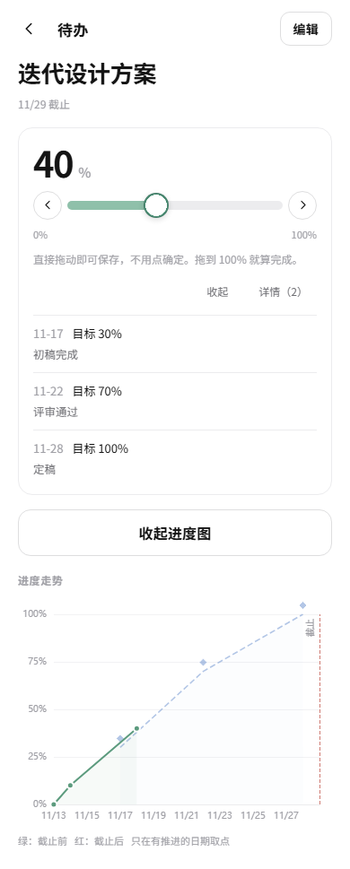
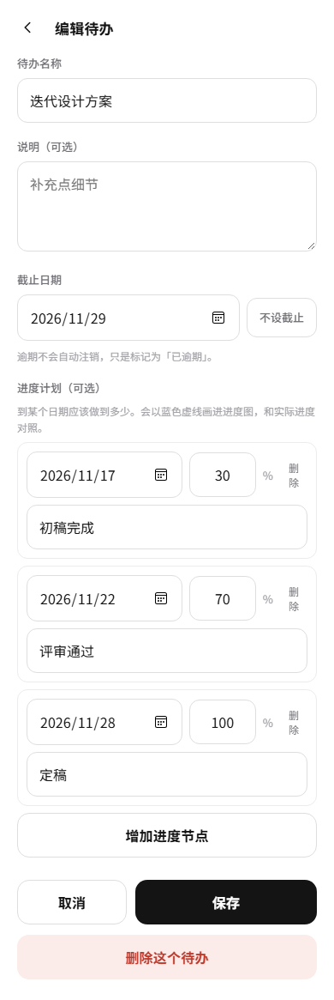
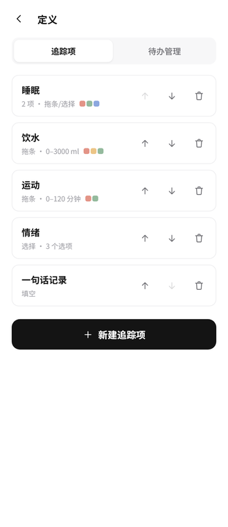

# LifeTrack

**记录过去，规划未来。**

一个完全跑在本机的每日记录工具。没有账号，没有服务器，数据只存在你自己的设备里。

  

---

## 为什么做它

每天在脑子里过一遍「今天干了什么」很累，说给 AI 听又得重新组织语言。

而大多数记录类 App 要求注册、联网、上传——你的睡眠、情绪、待办，都成了别人的数据。

LifeTrack 的出发点很简单：**把这些留在自己手里**。

---

## 四个关键词

### 高隐私：数据不出本机

所有内容存在浏览器的 IndexedDB（软件版在应用私有目录）。
没有登录、没有云同步、没有埋点。断网照常使用。

### 高和谐：一套数据，到处流通

追踪项、待办、事项、预安排不是四个孤立的功能，而是同一份记录的不同切面：

- 今天的待办推进，会进当天的概览和日历
- 待办的进度，能画成一条按时间走的折线
- 日历上点任意一天，看到那天的事项、待办、记录
- 每一项的自定义颜色，在记录页、日历热力图、饼图里是同一个

### 强适配：每个模块自己定义

一个「追踪项」下面可以放若干个模块，每个模块单独选类型：

| 类型 | 用于 |
|---|---|
| 填空 | 一句话记录、备注 |
| 选择 | 情绪、质量这类离散状态 |
| 拖条 | 睡眠时长、饮水量这类连续值 |
| 时间 | 入睡时刻、配速（时/分 或 分/秒，支持跨零点） |

每个模块能加警戒线、切段上色、自己命名。**没有预设的「标准模板」**，你记什么就长什么样。

### 高轨迹：看得见的变化

- 首页「近 7 天」用深浅表示每天的充实度
- 「未来 7 天」用蓝色深浅表示日程密度
- 日历是一张可以回看的热力图
- 图表支持折线、柱状、饼图，横轴从 7 天到自定义区间

---

## 功能一览

  
  
   
  逐项填写，填一项存一项　·　趋势、分布、自定义区间

  
  
   
  热力图，点开看当天全部信息　·　一键复制的当日总结

  
  
   
  实际进度（绿）与计划节点（蓝）对照　·　截止日、进度节点、执行标准

  
   
  追踪项与模块，全部自定义

**还有**：待办（含长期任务与已完成折叠）、事项（时间段）、明日预安排、备份导出/导入、软件版（离线 APK）。

---

## 技术

- Vite + React 18 + TypeScript，手写 CSS，没有 UI 框架
- ECharts 画图表
- IndexedDB 存储，localStorage 兜底
- 软件版是一个 WebView 壳，网页资源打包在 APK 内，断网可用

---

## 版本

- 网页版 **7.1.2**
- 软件版 **8.7.1.2**（前缀 8 表示软件版，末位是软件侧微修次数）

版本号每一轮改动都会推进；软件版可以在设置里检查更新。

---

## 说明

这是一个个人项目，为自己用而做。没有团队、没有商业化计划。

如果它对你也有用，欢迎自取；数据始终在你手里。
